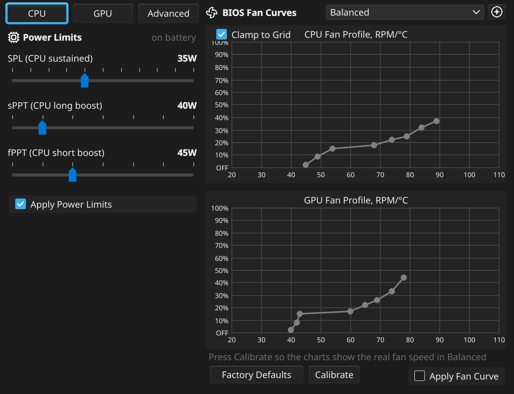

<h1 align="center">
  <br>
  Shiftray
</h1>

<p align="center">
  <b>asusctl and Cardwire in one small app.</b> Power modes, fans, GPU modes, keyboard lighting,<br>
  battery and the Fn keys for ASUS laptops on Linux. Its windows follow <a href="https://github.com/seerge/g-helper">G-Helper</a>'s design.
</p>

<p align="center">
  <a href="https://github.com/sprinterz5/shiftray/releases/latest"></a>
  <a href="https://github.com/sprinterz5/shiftray/releases"></a>
  <a href="https://copr.fedorainfracloud.org/coprs/thesecondone/shiftray/"></a>
  <a href="LICENSE"></a>
</p>

<p align="center">
  <a href="https://github.com/sprinterz5/shiftray/releases/latest/download/shiftray-x86_64.AppImage"><b>⬇ Download the AppImage</b></a>
  &nbsp;·&nbsp; <a href="#install">Fedora and Arch packages</a>
  &nbsp;·&nbsp; <a href="#troubleshooting">Troubleshooting</a>
  &nbsp;·&nbsp; <a href="ROADMAP.md">Roadmap</a>
</p>

<p align="center">
  <br>
  <sub>The same window in a dark and a light desktop theme: the app follows yours.</sub>
</p>

> [!NOTE]
> **Formerly asus-tso-helper.** Same app, new name since 0.7.0; installs update and keep their settings.
>
> **Early release.** Built and tested every day on an ASUS TUF Gaming A15 (FA507NV), Fedora 44,
> KDE Plasma 6 on Wayland; GNOME is supported since 0.10.0. Other ASUS laptops supported by asusctl
> should work, but nobody has confirmed them yet. If you try one, a [report](#reporting-a-problem)
> helps a lot.

## Why

- **On the official stack.** asusd (asusctl) and Cardwire do all the hardware work; the app is a
  window for them. It writes no hardware files itself, and its settings stay in asusd, so they
  keep working with the app closed and never fight other asusd tools.
- **Nothing hidden, everything undoable.** Before any password prompt the app lists what it will
  change and why. Extra → System changes shows every change it made with an Undo button
  ([details](#what-it-changes-on-your-system)).
- **G-Helper's design.** Small windows that open at the tray icon, the same layout and defaults.
  The interface is [seerge's](https://github.com/seerge) work.
- **KDE and GNOME.** On GNOME, which shows no tray icons by itself, Setup turns on the AppIndicator
  extension so the icon is there; toasts, the logout prompt and the keyboard light timeout use
  GNOME's own ways ([details](#requirements-and-support)).
- **Lightweight.** A single 30 MB AppImage, or a 250 KB package on the system's Python and Qt. In
  the tray it starts no background processes, only reads a few system files every 2 seconds.
  Memory is the weak spot: Python and Qt cost about 60 MB with the package and about 100 MB with
  the AppImage ([why](#it-uses-100-mb-of-memory)).
- **Notices things and says so.** When the battery drained in sleep, when it charged past the limit
  while the laptop was off, when an app keeps the NVIDIA GPU awake on battery, when a game runs in
  Eco or Silent, when a monitor on HDMI gets no picture, a notification says it once, with a button
  to fix it. Nothing changes unless you press it.
- **Finds what fights it.** TLP, auto-cpufreq, TuneD, supergfxd, KDE's own power profiles or the
  desktop's charge limit changing the same things show up in Setup and the main window, with the
  fix ([details](#what-it-changes-on-your-system)).
- **Eco without a logout.** GPU modes go through [Cardwire](https://opengamingcollective.github.io/cardwire/):
  Eco and Standard switch in a moment. Laptops without a discrete GPU (Strix Halo, Zenbook,
  Vivobook) get no GPU block at all.
- **One password, once.** On first start a Setup window installs what the laptop still needs
  (asusd, Cardwire, the key rule, the tray extension on GNOME) behind a single prompt. No terminal
  steps.
- **Updates in one click.** A red version label means a new release: one click downloads it,
  checks GitHub's SHA-256 and restarts into it.

## Features



**Performance**
- Silent, Balanced, Turbo and your own custom modes; each power source remembers its mode
- Fan curves for CPU and GPU, calibrated to real RPM, with factory defaults
- CPU power limits (SPL, sPPT, fPPT), NVIDIA Dynamic Boost and temperature target
- CPU Boost and the CPU's power mode (EPP) per mode
- Situations (experimental, [below](#situations)): On the go, Desk, Gaming, Quiet, each setting the
  mode, GPU, screen and keyboard light with one click, from the window or the tray menu

**GPU**
- Eco, Standard, Ultimate (MUX) and Optimized (Eco on battery)
- The tray tooltip names the apps keeping the dGPU awake; on battery a notification names them too
- A game started in Eco or Silent gets a hint to switch; or, if you turn it on in Extra, the mode
  switches by itself (say Turbo on the charger, Balanced on battery) and comes back when you quit.
  Steam, Proton, Wine, Lutris and Heroic games are recognised, Steam ones by name
- A monitor on the NVIDIA GPU's HDMI port that KDE did not pick up (it started in Eco) is turned on
  without a logout; Optimized stays in Standard while one is plugged in
- Memory for the integrated GPU, where the firmware offers it (Extra)

**Screen, keyboard, battery**
- 60 Hz, max Hz or automatic by power source, panel overdrive
- Aura effects, colour, speed, brightness, backlight timeout, lighting on boot and sleep
- Charge limit (only the values the firmware keeps, on models that take just 60 / 80 / 100),
  one-time charge to 100%, battery health, time left or time to the limit
- Battery history, what each mode drew, how much a night's sleep cost, wear over months

**Keys and system**
- Actions for Fn+F4, the Armoury key and other laptop keys, plus any keyboard shortcut
- MangoHud toggle, clamshell mode, run on startup
- Diagnostics in one click, and a problem report that opens a GitHub issue already filled in
- BIOS for your model (the ASUS source G-Helper uses), kernel, NVIDIA driver, asusctl,
  Cardwire and firmware updates in one window
- Light and dark theme following the desktop, optionally in the desktop's accent colour
- English, Russian, German, Spanish, Polish, Brazilian Portuguese and Simplified Chinese; a translation is one JSON file (fixes from native speakers welcome)

<br clear="right">

## Situations


An experimental layout, off by default: **Extra → Other → Situations**. Four tiles take the place
of the Mode, GPU Mode and Screen blocks:

- **On the go**: Silent, Eco, 60 Hz, dim keyboard light
- **Desk**: Balanced, Standard, max Hz
- **Gaming**: Turbo, Standard, max Hz, bright keyboard light
- **Quiet**: Silent, Optimized, automatic Hz, keyboard light off

One click sets all four, so a tile always gives the same result. Under the tiles the picked
situation's settings can be changed (Ultimate included) and then folded away. Turn it off and the
classic layout is back.

<br clear="right">

## Install

On Fedora and Arch, the package is the better choice: it uses about 40% less memory than the AppImage
and updates with the system. The AppImage runs anywhere and needs no terminal.

### AppImage (any distribution)

Download [`shiftray-x86_64.AppImage`](https://github.com/sprinterz5/shiftray/releases/latest/download/shiftray-x86_64.AppImage),
then run it:

```bash
chmod +x shiftray-x86_64.AppImage
```

```bash
./shiftray-x86_64.AppImage
```

It adds itself to the app menu and opens Setup for anything the laptop is missing. Runs on
distributions with glibc 2.34 or newer: Fedora 35+, Ubuntu 22.04+, Debian 12+, Arch.

### Fedora (COPR)

For Fedora 43, 44, 45 and rawhide. asusctl and Cardwire come from the Terra repository, which
the app's Setup adds.

```bash
sudo dnf copr enable thesecondone/shiftray
```

```bash
sudo dnf install shiftray
```

Coming from the AppImage: settings carry over. Start the installed Shiftray once and it points the
menu entry and autostart at itself; then delete the `.AppImage` file.

### Arch (AUR)

`shiftray` goes up on the AUR as soon as its registration reopens. Until then, build it
from [`packaging/aur/PKGBUILD`](packaging/aur/PKGBUILD) with `makepkg -si`. Cardwire is in the AUR.

### From source

```bash
git clone https://github.com/sprinterz5/shiftray
```

```bash
./shiftray/bin/shiftray
```

Needs Python 3 with PySide6, python-evdev and dbus-python. Build the AppImage with
`packaging/appimage/build-in-podman.sh`.

## Requirements and support

| Needs | |
|---|---|
| **Laptop** | An ASUS laptop supported by [asusctl](https://asus-linux.org), ROG and TUF first of all |
| **GPU modes** | [Cardwire](https://opengamingcollective.github.io/cardwire/) and a kernel with BPF LSM (Fedora and Arch have it; Ubuntu needs a boot option). Laptops with only an integrated GPU (Strix Halo, Zenbook, Vivobook) need neither: the GPU block is hidden |
| **NVIDIA driver** | Optional: for games on the dGPU and its temperature |

| Desktop | Status |
|---|---|
| **KDE Plasma 6** | Main target, everything works: on-screen toasts, the logout prompt, windows opening at the tray icon |
| **GNOME** | Supported: Setup installs and turns on the AppIndicator extension for the tray icon (no logout when it was already installed). Toasts are short notifications, the logout prompt and screen-off key are GNOME's, the keyboard light timeout uses GNOME's idle monitor. Windows open where GNOME places them, not at the tray icon |
| **Sway, Hyprland, other wlroots** | Should work; refresh rate through `wlr-randr` |
| **X11** | Refresh rate through `xrandr` |

GNOME 50 was tested in a nested GNOME Shell on the same laptop, wlroots in containers; neither on a
real desktop session yet. A [report](#reporting-a-problem) from one helps.

## GPU modes

| Mode | What it does | Switching |
|---|---|---|
| **Eco** | Only the integrated GPU; the NVIDIA GPU powers off | A moment, no logout |
| **Standard** | Both GPUs; the NVIDIA GPU sleeps until a game or app uses it | A moment, no logout |
| **Ultimate** | The NVIDIA GPU drives the screen directly (MUX), for the most FPS | Reboot |
| **Optimized** | Eco on battery, Standard when plugged in; stays in Standard while a monitor is on the NVIDIA GPU's port | Automatic |

On many ASUS laptops HDMI is wired to the NVIDIA GPU, so in Eco it shows nothing; see
[A monitor on HDMI shows nothing](#troubleshooting).

Eco and Standard go through Cardwire, the successor of supergfxd from the asus-linux and Open
Gaming Collective people. It never unloads the NVIDIA driver: it stops new programs from opening
the dGPU, which then powers down by itself. Programs already using the dGPU keep it awake until
they quit; the app names them and offers to close them.

## What it changes on your system

Day to day, the app only talks to asusd, Cardwire and the desktop. A few one-time steps change
the system; each is asked for, explained first, and listed in **Extra → System changes** with
Undo (the root ones together, one password):

| Change | When | Risk | Undo |
|---|---|---|---|
| udev rule: your user may read the ASUS hotkey device (not the keyboard) | Setup, for Fn keys | low | Undo |
| Your group may switch CPU boost (`/etc/tmpfiles.d`) | Setup, for CPU Boost per mode | low | Undo |
| KDE's power profile on plug / unplug set to "leave unchanged" | first start on KDE | low | Undo (old values restored) |
| Terra repository (Fedora) | Setup, for asusctl and Cardwire | medium | shown: `dnf remove terra-release` |
| power-profiles-daemon instead of tuned-ppd (Fedora) | Setup | medium | Undo |
| Cardwire instead of supergfxd | Setup | medium | shown: re-enable supergfxd |
| Kernel option `mem_sleep_default=deep` | Extra → Deep sleep (S3 laptops only) | high | Undo |
| KDE's PowerDevil starts without ddcutil (a drop-in in your home folder) | Setup, on KDE with Secure Boot and ddcutil 2.x, where PowerDevil crashes in Eco ([ddcutil#641](https://github.com/rockowitz/ddcutil/issues/641)) | low | Undo |
| GNOME's AppIndicator extension installed (if missing) and turned on | Setup, on GNOME, for the tray icon | low | Undo turns it off; the package is in "Installed packages" |
| Autostart, menu entry, KWin placement script (home folder) | first start | low | Undo |

The list lives in [`system_changes.py`](shiftray/system_changes.py); a change that is not
there is a bug.

**Tools that change the same things.** TLP, auto-cpufreq, TuneD, supergfxd (next to Cardwire),
optimus-manager, system76-power, EnvyControl and g-helper-linux all set the power mode, the charge
limit or the GPU themselves, so modes stop sticking or the dGPU misbehaves. The app shows them in
Setup and as a line in the main window; Set up stops the services (Undo starts them again) and
says how to remove the rest. See [`conflicts.py`](shiftray/conflicts.py).

## Troubleshooting

<details>
<summary><b>A monitor on HDMI shows nothing</b></summary>

On many ASUS laptops the HDMI port is wired to the NVIDIA GPU. In Eco that GPU is off, so the port
is dead; Optimized stays in Standard while a monitor is plugged in there. If KDE started in Eco and
you switched to Standard later, KDE has not picked up the NVIDIA GPU yet: Shiftray notices and
offers **Turn on**, which announces the GPU to KDE again (one password, no logout). While a monitor
is on that port, the NVIDIA GPU stays awake.
</details>

<details>
<summary><b>It uses 100 MB of memory</b></summary>

That is the AppImage. Most of it is Python and Qt: an empty Qt window with a tray icon
already takes about 40 MB. The AppImage carries its own copies of both, so nothing is
shared with the desktop, and its runtime adds a second process of about 20 MB. The Fedora and Arch
packages use the system's Qt, which KDE has loaded anyway: about 60 MB of real memory. A smaller
tray part without Qt is on the [roadmap](ROADMAP.md).
</details>

<details>
<summary><b>The Fn keys do nothing</b></summary>

The app needs read access to the "Asus WMI hotkeys" device, and nothing else from the keyboard.
Open **Extra → Setup**; the "Laptop keys" row installs the rule. Some keys (Fn+F2 / F3 keyboard
light, Fn+Esc Fn-Lock) are handled by the firmware and never reach Linux.
</details>

<details>
<summary><b>Eco is on, but the NVIDIA GPU stays awake</b></summary>

A program opened it before the switch and still holds it. Hover the tray icon: the tooltip names
it. Close it, or turn on **Extra → Stop all apps using GPU when switching to Eco**.
</details>

<details>
<summary><b>A red line says asusd or cardwired is not running</b></summary>

Click it to start the service. If that does not help, open **Extra → Setup**. On Ubuntu the
kernel starts without BPF LSM, which Cardwire needs; see
[Cardwire's docs](https://opengamingcollective.github.io/cardwire/).
</details>

<details>
<summary><b>The mode changes by itself when I plug in the charger</b></summary>

That is on purpose: each power source remembers the mode last used on it, as in G-Helper. Pick
the mode you want on battery once, and it comes back every time you unplug.
</details>

<details>
<summary><b>The battery charges past the limit</b></summary>

Most TUF and some ROG models stop charging only at 60-80% or at 100%; any other limit charges to
full, so the slider offers only 60, 80 and 100 there.

ASUS firmware also sets the limit back to 100% at every power-on (the same on Windows); asusd puts
yours back a few seconds after Linux starts, so the battery can gain a little while booting or
sitting in the BIOS. Some models do not hold the limit while switched off either: if the battery
came back above the limit after a shutdown on the charger, the app says so once. In sleep the
limit always holds, so a laptop that lives on the charger is better put to sleep than shut down.
If GNOME's "Preserve Battery Health" (or another UPower limit) is on with a different value, the
two overwrite each other: Setup shows it.
</details>

<details>
<summary><b>KDE lost the battery icon, screen dimming or the lid action</b></summary>

PowerDevil, KDE's power manager, crashes at start while Eco hides the NVIDIA GPU, on Secure Boot
systems with ddcutil 2.x (Fedora 44 among them; fixed in ddcutil 3.0). **Extra → Setup** has a row
for it: PowerDevil then starts without ddcutil, losing only external monitors' brightness over DDC.
</details>

<details>
<summary><b>No tray icon on GNOME</b></summary>

GNOME shows tray icons only with the AppIndicator extension. **Extra → Setup**, row "Tray icon on
GNOME", installs and turns it on. If it was just installed, log out and back in once: GNOME loads
new extensions at login. If all extensions are switched off in the Extensions app, switch them on.
Until then the window stays open as a normal app, and closing it quits.
</details>

<details>
<summary><b>CPU Boost is greyed out</b></summary>

Writing the boost switch needs a one-time permission: open **Extra → Setup**, row "CPU Boost switch".
</details>

<details>
<summary><b>Something else</b></summary>

The log is in `~/.local/state/shiftray/app.log`. Start the app with `--debug` to log every
command it runs. [docs/DEBUGGING.md](docs/DEBUGGING.md) maps symptoms to the code.
</details>

### Reporting a problem

**Extra → Diagnostics → Report a problem on GitHub** copies a text report and opens a new
[issue](https://github.com/sprinterz5/shiftray/issues) that says where to paste it: laptop model,
kernel, package versions, services, what asusd and Cardwire report, and their recent logs. Your
home folder, serial numbers and computer name are left out. "Save the report to a file" is there
too.

## Contributing

- **Testers with other ASUS laptops** help the most: a Diagnostics report and a few words on what
  works. ASUS mice, keyboards and headsets too; see [ROADMAP.md](ROADMAP.md).
- **Translations**: copy `shiftray/translations/ru.json`, translate the values, open a pull request.
- **Code**: plain Python and Qt (PySide6). [docs/ARCHITECTURE.md](docs/ARCHITECTURE.md) shows
  where everything is, [docs/DEBUGGING.md](docs/DEBUGGING.md) how to find a bug, and
  `python3 -m unittest discover -s tests -t .` runs the tests. [ROADMAP.md](ROADMAP.md) lists what
  is next.

## Credits

- **[G-Helper](https://github.com/seerge/g-helper) by seerge**: the interface, layout, colours,
  behaviour and defaults this app follows. If you like this app, support G-Helper too.
- **[asus-linux](https://asus-linux.org)** and **[Open Gaming Collective](https://github.com/OpenGamingCollective)**:
  asusctl / asusd and Cardwire, which do the actual hardware work.
- **[Lucide](https://lucide.dev)**: icons (ISC licence, `shiftray/assets/icons/LICENSE`).

## Support

Donations through GitHub Sponsors and Open Collective are being set up. Until then, a ⭐ and a
report from your laptop help the most.

## License

[GPL-3.0](LICENSE), like G-Helper.

An unofficial project, not affiliated with the G-Helper project. Not affiliated with or endorsed by ASUS. ASUS, ROG and TUF are trademarks of ASUSTeK Computer Inc.
